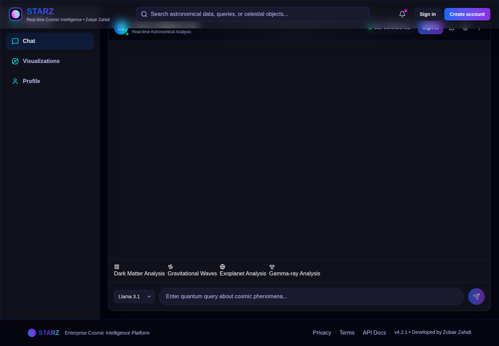

# STARZ NEXUS

A space-themed conversational application prototype with a React frontend, a TypeScript API, MongoDB, and Ollama integration. The source includes MongoDB, Redis, Socket.IO, and Ollama integration.


## Inside the project

| Directory | Purpose |
| --- | --- |
| `frontend/` | React interface, TypeScript, Vite, client state, and visual components. |
| `starz-nexus-backend/` | Express API, TypeScript server, authentication dependencies, database and AI integration. |
| `docker-compose.yml` | Container service configuration. |

## Development setup

Install Node.js and the services required by your selected configuration. Review the supplied environment examples and backend configuration; create your local `.env` files without committing credentials. Ollama models are separate downloads.

```bash
git clone https://github.com/Zubair-zahidi/starz-chatbot-ui.git
cd starz-chatbot-ui/starz-nexus-backend
npm ci
npm run dev
```

In a second terminal:

```bash
cd starz-chatbot-ui/frontend
npm ci
npm run dev
```

Open the URL printed by Vite. Both packages provide build scripts. The backend also defines test scripts; their existence alone does not establish test coverage or a passing deployment.

## Interface previews


## Status and limits

Treat this as a development prototype. Validate its service configuration, authentication, data handling, and model behavior before production use. Container configuration does not provide automatic scaling, and an AI response requires human review.

The related `starz-nexus` and `STARZ-NEXUS---Enterprise-Cosmic-Intelligence-Platform` repositories are legacy project entries. This repository contains the implementation.

Created by **Zubair Zahidi**. See [contributing guidance](CONTRIBUTING.md) and the existing [license](LICENSE).

## Configuration and verification

Use Node.js 24, MongoDB, and the services specified in the backend environment example. Ollama and its models are separate; a running API does not establish working inference. The Vite development proxy targets port 3001 by default. Use `VITE_API_URL` for an alternative API origin and configure backend CORS for that origin.

Production startup requires a unique `JWT_SECRET` of at least 32 characters. Without an explicit development secret, a temporary key is generated and tokens expire across restarts. Password-reset mail delivery remains unimplemented; configure and validate it before offering production account recovery.

Both packages build with `npm run build`. Against a backend using a **disposable test database**, run `TEST_BASE_URL=http://localhost:3001 node tests/api-regression.mjs` from `starz-nexus-backend/`. It creates a test account and checks authenticated profile access and refresh-token rejection on access routes.

## Cloud review preview



Captured from the running project on 22 October 2026. The interface runs against a local MongoDB-backed API. Live Ollama inference was not exercised.
