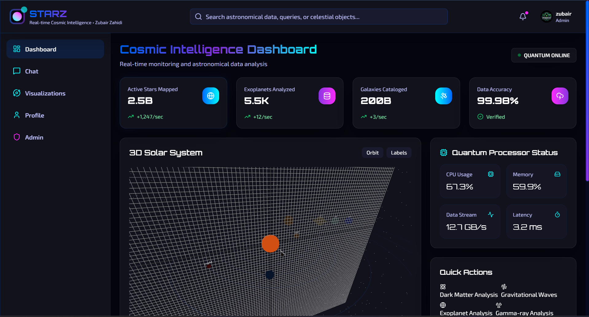
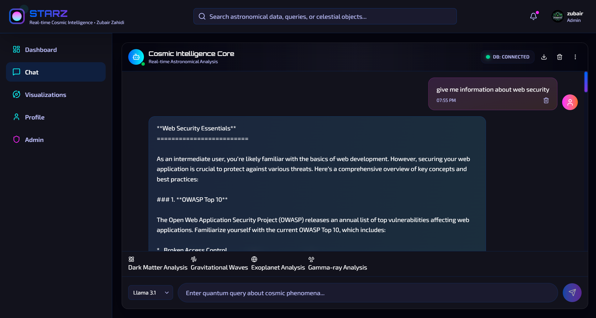
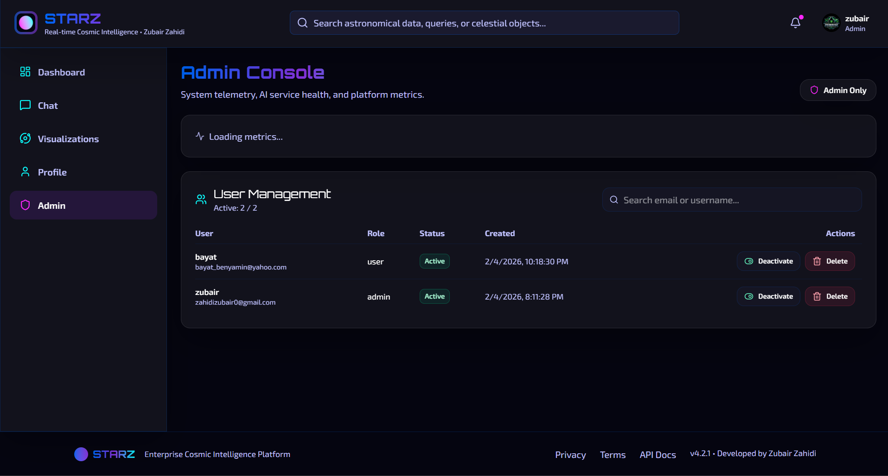

# STARZ NEXUS

A conversational application prototype with a React and TypeScript frontend, a Node.js backend, and a space-inspired interface. The source includes MongoDB, Redis, Socket.IO, and Ollama integration.



## Inside the project

| Directory | Purpose |
| --- | --- |
| `frontend/` | React interface, TypeScript, Vite, client state, and visual components. |
| `starz-nexus-backend/` | Express API, TypeScript server, authentication dependencies, database and AI integration. |
| `docker-compose.yml` | Container service configuration. |

## Development setup

Install Node.js and the services required by your selected configuration. Review the supplied environment examples and backend configuration; create your local `.env` files without committing credentials. Ollama models are separate downloads.

```bash
git clone https://github.com/Zubair-zahidi/starz-chatbot-ui.git
cd starz-chatbot-ui/starz-nexus-backend
npm install
npm run dev
```

In a second terminal:

```bash
cd starz-chatbot-ui/frontend
npm install
npm run dev
```

Open the URL printed by Vite. Both packages provide build scripts. The backend also defines test scripts; their existence alone does not establish test coverage or a passing deployment.

## Interface previews




## Status and limits

Treat this as a development prototype. Validate its service configuration, authentication, data handling, and model behavior before production use. Container configuration does not provide automatic scaling, and an AI response requires human review.

The related `starz-nexus` and `STARZ-NEXUS---Enterprise-Cosmic-Intelligence-Platform` repositories are legacy project entries. This repository contains the implementation.

Created by **Zubair Zahidi**. See [contributing guidance](CONTRIBUTING.md) and the existing [license](LICENSE).
